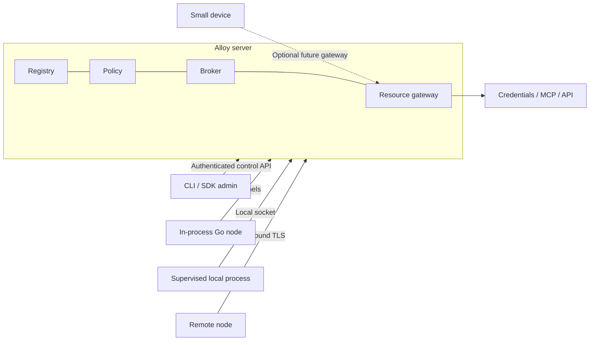

# Product and architecture

**Status: engineering proposals, not a settled implementation contract.** The [product vision](vision.md) defines Alloy as an engine for a growing personal intelligent system. SDK-led server construction, ordinary connected nodes, shared capabilities, and brokered events are the direction. Exact APIs, manifests, execution modes, delivery guarantees, storage, and transports below remain candidates. The Alloy MCP interface for existing agents is distinct from upstream MCP resources.

## Mental model

- **Server**: the authoritative coordinator for one Alloy instance: registry, policies, resource broker, job routing, state and audit. The server can host normal nodes, but its control plane is not just another node.
- **Node definition**: code plus a manifest declaring identity, handlers, requested capabilities and execution requirements. A project can contain definitions under `.agents/nodes/`; registration into a server is a separate, authorized action.
- **Node instance**: one running copy with a server-issued identity. Several instances of a logical node can compete for the same subscription.
- **Resource**: an explicitly configured capability, such as a native provider/service connection, MCP tool, approved host operation, or storage/workspace access. A resource is not automatically available just because a CLI or directory exists somewhere. Native service connections need not become Alloy-specific operation wrappers.
- **Harness configuration**: a composition of approved connections and native options, not another inference router. It can reference provider access, MCP gateways, skills, and a workspace while preserving the harness's own session, tool, and execution APIs. See [server composition](server-structure.md#harness-options-compose-approved-capabilities).
- **Execution location matters**: distinguish server-exposed access from node-local execution. A server-executed operation uses its configured host identity; a native gateway connection may forward authorized requests to an upstream service without moving a node-local harness or workspace. A node-local service runs in the node's own environment (for example, watching project files or invoking a local tool). Each has its own host, identity, permissions, and availability. Directories, remote workspaces, and tunnels require explicit access semantics; references alone do not move data or execution.
- **Event**: a fact published under a typed subject. Each matching logical subscription receives its own delivery. **Job**: a delivery to one logical subscription, processed by one of its competing instances. An event can produce zero or many jobs.
- **Host runner**: an optional process on a machine that starts and supervises assigned nodes. A self-managed remote node may connect without granting the server power to execute arbitrary code on its host.



One server is an administrative boundary with its own identity, data directory, keys, policy and namespace. Separate servers do not share credentials or state by default. Server identity must be verified even for remote nodes on trusted networks.

## Proposed boundaries and tradeoffs

1. **Central coordination first**: publishing, subscription changes, durable acceptance, resource authorization and audit go through the server. Do not make every node a server in v1: decentralized trust, discovery and revocation complicate the basic product. Nodes can offer resources later through explicitly registered providers; initially those providers are local to the server and narrowly scoped.
2. **Separate definition from binding**: a manifest says what a node needs, not a fixed server credential. `nodes add` binds a definition to an instance and reviews requested capabilities. Runtime configuration selects a named server profile or URL; credentials are never checked into the project. Multiple environments may bind the same definition differently.
3. **Secure functionality, not identical environments**: SDK operations look consistent across placements, but binaries, local filesystem, OS, network, credentials and trust do not. Host-local operations explicitly name their execution host. An offline node cannot use an online server resource.
   Server resources and node-local services are separate concepts: brokering a server resource does not move node work onto the server, and a node-local service does not automatically gain server credentials. A node may compose both, subject to explicit grants.
4. **Transport is an implementation detail; semantics are not**: the engine chooses an eligible transport based on placement, policy and delivery mode, not an unmeasured claim that one is always fastest. User overrides are diagnostic/advanced and cannot weaken required guarantees.
5. **No ambient authority**: registering a node does not grant access to all server resources, shell commands, other nodes or the host's credentials. In-process nodes are trusted as server code, not isolated tenants.
6. **Native protocols over universal wrappers**: registry/discovery, authentication, and authorization can be shared without forcing inference, MCP, filesystem access, and tunnels through one protocol or the event broker. Prefer native clients and pluggable server-side authentication; add protocol-specific enforcement only for controls Alloy actually supports. Future path/placement optimization cannot weaken authority, change semantics, or silently relocate work.

## Developer experience sketch

```sh
alloy server init --name home       # creates config; does not expose a listener
alloy server start --config alloy.yaml
alloy server list                   # local profiles/instances, not global discovery
alloy server status home
alloy server stop home              # stop by instance identity, not source filename
alloy nodes add .agents/nodes/watch --server home
alloy nodes list --server home
alloy nodes run watch --server home # explicit local runner, unless configured otherwise
alloy resources add github deploy-api --server home
alloy secrets put github-token --server home  # hidden prompt or stdin, never argument value
```

`alloy server start main.go` is one possible convenience wrapper, but requires a Go toolchain, executes arbitrary code, and does not work for a stopped process identified solely by filename. The intended journey is SDK-led server construction by a user or coding agent, not custom servers as an advanced-only exception. A prebuilt server with declarative configuration remains an option, not a selected default. CLI commands and launch behavior above are sketches. Agent-facing CLI support should provide structured output, stable errors, and explicit noninteractive approval behavior. List must distinguish configured profiles, locally running processes, and reachable remote servers; it cannot discover every server automatically.

Illustrative node manifest:

```yaml
apiVersion: alloy.dev/v1alpha1
kind: Node
name: watch-deployment
runtime: python
entrypoint: main.py
subscriptions:
  - subject: deploy.requested.v1
    delivery: durable
publishes: [deploy.finished.v1]
resources:
  - name: deploy-api
    operations: [deployment.read, deployment.create]
```

Manifest requests are not grants. Installation pins source/lockfiles; registration records the manifest digest and approved permissions. Changed permissions or code require review according to policy. Sketches for a common handler model, not final signatures:

```go
node.On("deploy.requested.v1", func(ctx alloy.Context, job alloy.Job) error {
    // ctx.Resources().Call(...) and ctx.Publish(...) are policy checked.
    return nil // SDK acknowledges only after successful return
})
```

```python
@node.on("deploy.requested.v1")
async def deploy(ctx, job):
    await ctx.publish("deploy.finished.v1", {"id": job.data["id"]})
```

```ts
node.on("deploy.requested.v1", async (ctx, job) => {
  await ctx.publish("deploy.finished.v1", { id: job.data.id });
});
```

No assumption of transactional coupling between a handler's publish and acknowledgement: duplicates and missing downstream events are possible on crashes. Supply an explicit transactional outbox only when implemented; application side effects need idempotency keys.

## Messaging contract

The following is a candidate contract if these delivery modes are adopted, not a promise that Alloy will implement both modes or their mechanisms before a useful local system. Decide required guarantees with a real scenario first.

The envelope includes protocol version, event ID (UUID/ULID), subject and schema version, producer identity assigned/verified by server, timestamp, content type, payload, correlation/trace and causation IDs, optional expiry and idempotency key. Deliveries additionally carry subscription ID, attempt, lease/deadline and delivery ID. Bound payload and metadata sizes; store large objects separately and reference them. JSON is the first application payload format; an optional schema registry and binary payloads can follow. Never use a client-supplied source field for authorization.

- **Ephemeral**: accepted into bounded memory; no recovery after process crash, at-most-once per attempted delivery, no replay. Slow subscribers may be rejected/dropped according to an explicit policy; expose the outcome. Suitable for telemetry and disposable local notifications.
- **Durable**: publish succeeds only after the event and its per-subscription deliveries are committed to durable local state; subscriptions are matched at acceptance time. Each delivery is leased to one instance and acknowledged after success. Lost leases/restart trigger retry, so delivery is at least once, not exactly once. TTL, bounded attempts, exponential backoff with jitter and dead-letter inspection/replay are configured per subscription. Disk-full and queue-full reject publish; no silent downgrade to memory.
- **Fan-out and workers**: distinct logical subscriptions each get a copy; replicas of one subscription compete. The initial model does not promise ordering; handlers must tolerate concurrent and duplicate delivery. Add partitioned ordering only with defined key, concurrency, retry and failover semantics.
- **Offline nodes**: durable deliveries wait subject to retention/quotas; ephemeral events are lost. Backpressure is bounded per subscriber and globally; one blocked subscriber must not stall routing to others. Publishing receipts report accepted/rejected, not completed work.
- **Failures**: ack after side effect can duplicate it; ack before side effect can lose it. Support stable idempotency keys, document external-service limitations, and expose delivery attempts. A server restart must recover committed deliveries; a node crash must release/expire leases. Cancellation and timeouts must not be represented as successful completion.

## Transport policy

This section preserves an earlier gRPC/protobuf proposal for evaluation, not a selected canonical transport. HTTP/WebSocket prototype work is separate evidence; the API and transport choice remains open.

Candidate protocol: versioned protobuf messages and gRPC bidirectional streaming over TLS for remote nodes; a Unix-domain socket on supported local systems (and a separately designed Windows local transport). gRPC's streams support flow control and multiplexing, but reconnect, application-level ack, replay, queue limits and auth remain Alloy's responsibility. Connections would originate from remote nodes, so NAT usually needs no inbound node port; server discovery and reachability are still required.

For trusted in-process Go nodes, bounded channels avoid serialization and network syscalls. The same broker, authorization decision, schema validation, quotas, and durable commit/ack rules must apply; the channel is a delivery adapter, never a bypass. Only ephemeral local messages can bypass persistence, and only when explicitly configured. A remote resource call still passes through the resource gateway. Python/TypeScript run as processes in v1; no claim of cross-language in-process channels. Same host does not imply same process or trust.

Local peer credentials/socket permissions are defense in depth, not a substitute for application identity, especially with containers or shared user accounts. Remote connections use verified TLS; a resource-sensitive session authenticates the node. If a transport becomes unavailable, reconnect with exponential backoff and resume outstanding durable deliveries; do not silently change semantics or trust. Connection negotiation exchanges protocol versions, capabilities, limits and instance identity, rejects incompatible peers, and reports the selected path through status/metrics. Compression is opt-in above a measured payload threshold, never assumed beneficial.

NATS/JetStream is a credible later backend for larger deployments; it adds operations and its own security/retention model. MQTT can be a later constrained-device gateway. WebSocket is an alternative where proxies prevent gRPC, not an initial second protocol. Shared memory, direct peer-to-peer, QUIC and automatic fastest-path benchmarking are future experiments, not MVP requirements. Any alternate transport must pass the same conformance suite.

## Earlier repository assessment and migration proposal

The inventory below is a historical planning snapshot, not a fresh implementation audit. Use prototype notes and current source to establish what works today; the root README is now a product entry point, not a task list.

The working tree has ongoing user changes; preserve them. `engine/dispatcher.go` already uses typed subject subscriptions, per-logical-node worker channels and copies payloads on fan-out; its legacy source router remains for untyped jobs. `engine/engine.go` registers nodes and subscriptions before starting, injects shared Go services and listens on `:8080` by default. `engine/poll.go`, `engine/webhook.go` and `engine/tunnel.go` are existing integration building blocks, not an authenticated remote node protocol. The current dispatcher is in-memory, has no persistent ack/lease, capability checks or cross-language protocol, and a blocked destination can delay a router. `cmd/test-alloy-server/server.go` is currently a stub. `README.md` contains the existing task list.

Extract routing and envelope interfaces behind tests rather than rewriting everything. Preserve current Go API temporarily as an explicitly trusted in-process adapter; migrate typed events first, mark legacy source routing deprecated only after a replacement test and example exist. Do not treat the existing HTTP listener/tunnel as secure remote access. Review shutdown/cancellation and lifecycle races before reuse; add crash and backpressure tests before asserting guarantees.
