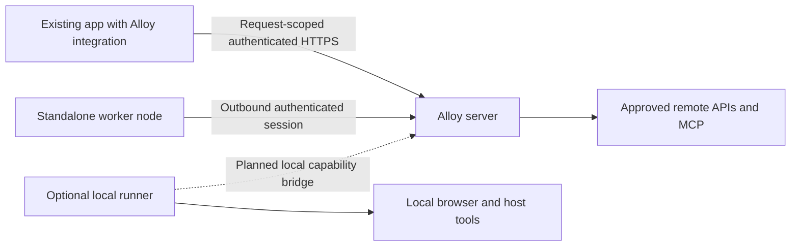

# Deploying Alloy and its nodes

Research date: **2026-11-23**. This is an architecture recommendation based on current official documentation, not a deployment implementation or a claim that the prototype is safe to expose publicly. No cloud accounts were accessed or resources created. Pricing and end-to-end platform compatibility have not been measured.

## Recommendation

Separate three experiences:

1. **Run Alloy:** a local service or a user-operated, long-running server with explicit identity/credential storage and ingress.
2. **Run a standalone node:** an optional managed service, finite job, or scheduled task deployed where its dependencies exist.
3. **Use Alloy in an existing system:** a normal SDK/protocol connection inside an application the user already deploys. Alloy should not take over that application's deployment.

Offer optional provider-assisted deployment, but ask **what needs to run and where** before asking users to log into AWS, Vercel, or Cloudflare. A successful cloud login does not establish that the platform supports the workload, provisions its runtime secrets, or makes local resources available there.

## Deployment shapes, not interchangeable provider names

- **Alloy server:** long-running connections, event routing, HTTP/SSE gateways, stable identity, and server-owned OAuth state. Begin with one active instance; the current memory-backed broker is not a horizontally scalable distributed service.
- **Watcher/worker:** a continuous process, often with an outbound node session. Needs an appropriate restart policy and must handle reconnects. It does not necessarily need public ingress.
- **Finite routine/agent job:** starts, performs work, reports completion, and exits. Native harness SDKs may require spawning a CLI and accessing a writable workspace; runtime support must be verified.
- **HTTP/scheduled function:** request-scoped work within platform limits. It may use Alloy resource connections, but cannot assume its subscription survives after the invocation ends. Push invocation, polling, or a queue-backed adapter would need explicit design.
- **Frontend/extension:** deployed or distributed through its normal ecosystem. Use an appropriate user/session flow, not embedded administrator or runner credentials.
- **Embedded SDK client:** stays in the user's existing application, CI job, or service. Supply connection configuration and narrow runtime identity, not a replacement deployment framework.

Package capabilities such as native subprocesses, filesystem access, connection lifetime, and persistent files separately from the selected cloud provider. Reject unsupported combinations rather than silently moving execution elsewhere.

## Where should the server run first?

**Local service first; a conventional VM or container host as the initial remote reference deployment.** This is an architectural fit assessment: the Go process and its optional CLI/stdio dependencies match a normal process environment with explicit storage and supervision.

Provide a binary/service-manager path and an OCI image/Compose example. Do not require every user to create a custom image; custom server projects may still build one when they add dependencies. A VM/container reference deployment still needs TLS, safe exposure, restart/shutdown behavior, backups, and credential rotation—it is not secure merely because it runs in Docker.

Managed containers are also candidates. Provider-specific adapters should build on a working reference artifact rather than become three separate Alloy architectures.

### AWS

Official docs identify **ECS Express Mode** as a managed path from a container image to an ECS service on Fargate, with HTTPS ingress, networking, scaling, and monitoring [S9]. It is a candidate for a hosted server or service node, not a tested Alloy deployment. Review storage and single-instance behavior explicitly; task/container files must not be assumed to survive replacement.

A user-operated VM is a simpler execution model for the current single-process/file-state design, at the cost of OS administration. Finite/event-driven AWS execution is a different node target; verify the specific runtime's duration and native-process capabilities rather than treating it as a daemon host.

**Do not propose App Runner for new customers:** AWS states that it is closed to new customers and recommends ECS Express Mode; existing customers can continue using it [S10]. Express Mode has no extra feature charge, but its underlying provisioned resources are billable. No fixed-cost estimate is implied.

### Vercel: distinguish Functions, containers, and Daemons

Current documentation contradicts the old blanket advice that Vercel cannot serve WebSockets:

- **Functions support WebSockets**, but connections close at the function's maximum duration. Reconnects can reach different instances, and durable coordination cannot rely on one instance's memory [S1, S2]. Supporting a socket is not equivalent to preserving Alloy's broker or supervised processes indefinitely.
- **Container Runtime is documented as Beta.** It supports OCI images and an HTTP-serving process, but retains Function limits and traffic-based scale-down behavior [S3]. Native dependencies are therefore possible; do not categorically claim that Vercel cannot run Go/binary dependencies. Actual harness compatibility still needs testing.
- **Daemons are documented as Public Beta** for continuously running containerized background workers, queue consumers, and job runners [S4]. They support outbound worker connections but explicitly do **not** support public inbound HTTP/TCP or persistent local storage. They currently run only in production deployments, not previews, and do not offer autoscaling. This is a candidate for outbound Alloy worker nodes, not the public broker. Restarts/rollouts still require reconnect and state recovery.

Vercel is consequently a legitimate node-deployment candidate, not only a frontend host. The full server still needs a verified ingress/state/lifecycle design; it should not be the first remote reference deployment based solely on WebSocket or container support.

### Cloudflare: distinguish Workers, Durable Objects, and Containers

- **Workers** are a candidate for frontend-adjacent HTTP logic and compatible SDK/protocol clients. Do not assume that JavaScript/Node compatibility supplies the Linux environment required by a native CLI SDK.
- **Durable Objects** provide a WebSocket coordination/hibernation model. Hibernation preserves accepted connections but discards in-memory object state; durable state must be stored or reconstructed. Eligibility conditions mean ongoing work or outbound connections can prevent hibernation [S5]. This is a possible future edge adapter, not a drop-in deployment of Alloy's Go server.
- **Containers** are a distinct Workers Paid capability for arbitrary runtime/container workloads, including a documented Go example [S6]. They are controlled through Worker code and have provider-specific lifecycle/storage semantics [S7]. Validate restarts, routing, and state placement before selecting them for an always-on broker or agent worker.

Worker CPU limits and connection wall-clock lifetime are different things. Do not interpret a CPU-time budget as an identical WebSocket timeout, or market hibernation as transparent preservation of an arbitrary program.

### Other managed-container candidates

**Render** documents continuously running background workers and persistent disks for supported service types [S13, S14]. A public Alloy server would require an ingress-capable service, not just a worker. Its persistent-disk and deployment behavior should be tested with OAuth state and one active broker.

**Railway** documents runtime-mounted persistent volumes [S15]. **Fly.io** documents configurable Machine autostop/autostart [S16]. These are credible candidates, not ranked winners from this scan. Sleep/scale-to-zero is a product decision: saving idle compute can disconnect subscriptions and make resources unavailable until wake-up.

## Local intelligence does not automatically move to the cloud

Deploying Alloy elsewhere does not give that machine access to a laptop's browser, OS keychain, filesystem, local inference hardware, or existing terminal login.

There are two explicit choices:

- Keep the relevant execution on the local machine and connect through an authorized local runner/provider bridge.
- Deliberately provision a supported equivalent on the remote execution host, with appropriate sign-in, permissions, dependencies, and data access.

The first is a planned extension of the architecture, not a claim that our current gateway already bridges all local resources remotely. Do not copy a home directory or upstream login files as an onboarding shortcut. Authentication remains provider-specific and subject to provider policy.

An illustrative future topology—not implemented deployment behavior:

Request-scoped integration must use a compatible API/transport. A cold or suspended function is not an always-connected event subscriber.

## Optional deployment onboarding

Suggested flow:

1. **Choose the task:** run Alloy, deploy a standalone node, or connect an existing system. Existing applications should be able to skip deployment setup entirely.
2. **Inspect requirements:** service/job/function/frontend, native binaries, workspace writes, network/ingress, persistent files, and required capabilities.
3. **Choose a compatible target:** show local/current environment first, then supported provider paths. Explain adaptation and unsupported features.
4. **Authenticate only if needed:** prefer the user's existing authenticated provider CLI or a provider-supported authorization flow. Cloud account identifiers, project/team, region, and deploy scope must be explicit.
5. **Preview the plan:** build/artifact identity, resources, permissions, public routes, secret references, state placement, and known billable resource categories. Label any cost estimate and assumptions; do not promise a fixed bill.
6. **Approve and deploy:** review source/build scripts before execution. Do not put runtime/admin secrets into images, build arguments, source, or logs.
7. **Provision the node's runtime identity:** use the approved runner/profile model where implemented. Deployment credentials and runtime Alloy credentials are different authorities.
8. **Verify and manage:** check connectivity, effective grants, runtime health, logs, stop/redeploy, and cleanup. Node health is distinct from cloud deployment status.

Provider authentication should not become a new cloud-credential vault by default:

- **AWS:** prefer temporary credentials through the user's existing supported CLI/identity flow or a user-approved scoped role/template. Do not ask for root credentials or make long-lived access-key collection the default [S11].
- **Vercel:** native Git/CLI deployment is a useful first path; platform tokens should have the narrowest supported scope suitable for the specific operation [S12]. Creating a new project may need different authority than deploying an existing one.
- **Cloudflare:** Wrangler supports interactive login and scoped automation credentials. Creation and deployment permissions differ; make them visible rather than requesting broad account access [S8].

If Alloy later operates a hosted deployment service, unattended deployment needs its own scoped credential retention, expiry/revocation, account isolation, and audit design. A user-run CLI adapter does not automatically solve that different trust model.

## Suggested implementation order

1. **Local packaging:** one server binary/image, simple supervision, prepared node environments, and stable private configuration paths. No database requirement.
2. **One remote reference deployment:** a single-instance VM/container path, verified WSS/HTTP/SSE behavior, protected identity/OAuth state, and a deployed node reconnecting after restart.
3. **One optional managed-cloud adapter:** select from actual user demand and a live compatibility test. Generate reviewable native provider configuration and reuse native authentication before building a broad hosted deployment control plane.
4. **Specialized node targets:** Vercel Daemons/container jobs, Cloudflare Containers, and request-scoped integrations where appropriate. Each needs its own lifecycle/compatibility tests; no universal deploy button promise.

Before publicly hosting the current prototype, resolve TLS, instance identity and renewal, storage/refresh ownership, public OAuth callback handling, gateway scopes, and restart behavior. Current per-run node connection files are not an unattended runner-enrollment system. Scaling multiple instances also requires explicit event routing and shared-state semantics; an image and a load balancer alone do not provide them.

## Validation and open decisions

- Can a node reconnect after deploy/restart without exporting upstream credentials or repeatedly asking the user to approve the same profile?
- Which native SDK/binary/architecture combinations actually run on each target?
- What happens to WebSockets, SSE, in-flight tool calls, OAuth refresh, and ephemeral events during shutdown, sleep, and replacement?
- Does the provider permit the intended ingress and single-active-instance model? Can identity and refreshed OAuth state survive replacement safely?
- Can a local-resource dependency be detected before sending a job to a remote host?
- What permission scope is needed to create a new project versus update an existing deployment? Can it be revoked independently of the node?
- What is the observed idle and active cost for a representative personal workflow? No cost benchmark was performed in this scan.

## Sources

Official public documentation accessed on 2026-11-23. Platform features and availability can change; verify again when implementing an adapter. Vercel WebSockets/Container/Daemons, Cloudflare Containers, and App Runner availability were also inspected directly rather than relying on search snippets.

- **[S1]** [Vercel WebSockets](https://vercel.com/docs/functions/websockets): connection lifetime, reconnect behavior, and per-instance state.
- **[S2]** [Vercel function duration](https://vercel.com/docs/functions/configuring-functions/duration): plan/runtime-dependent limits; not a daemon contract.
- **[S3]** [Vercel Container Runtime](https://vercel.com/docs/functions/runtimes/container): OCI support, Beta status, HTTP port, scale-in, and Function limits.
- **[S4]** [Vercel Daemons](https://vercel.com/docs/daemons) and [limits](https://vercel.com/docs/daemons/limits): continuous processes, no public ingress/persistent local disk, and Public Beta restrictions.
- **[S5]** [Durable Object lifecycle](https://developers.cloudflare.com/durable-objects/concepts/durable-object-lifecycle) and [WebSocket hibernation](https://developers.cloudflare.com/durable-objects/api/websockets): connections versus in-memory state.
- **[S6]** [Cloudflare Containers](https://developers.cloudflare.com/containers/) and [getting started](https://developers.cloudflare.com/containers/get-started): runtime support and Go example.
- **[S7]** [Cloudflare Containers concepts](https://developers.cloudflare.com/containers/concepts/): lifecycle, scheduling, and storage considerations.
- **[S8]** [Wrangler general commands](https://developers.cloudflare.com/workers/wrangler/commands/general) and [Workers authorization](https://developers.cloudflare.com/workers/authorization/workers): provider login and deployment permissions.
- **[S9]** [ECS Express Mode overview](https://docs.aws.amazon.com/AmazonECS/latest/developerguide/express-service-overview.html) and [provisioned resources](https://docs.aws.amazon.com/AmazonECS/latest/developerguide/express-service-work.html): managed Fargate service and underlying resource costs.
- **[S10]** [App Runner availability change](https://docs.aws.amazon.com/apprunner/latest/dg/apprunner-availability-change.html): no new customers; existing-customer service continues.
- **[S11]** [AWS CLI IAM Identity Center](https://docs.aws.amazon.com/cli/latest/userguide/cli-configure-sso.html) and [programmatic credential guidance](https://docs.aws.amazon.com/IAM/latest/UserGuide/security-creds-programmatic-access.html): temporary credential paths.
- **[S12]** [Vercel Git deployment](https://vercel.com/docs/git), [CLI deploy](https://vercel.com/docs/cli/deploy), and [access tokens](https://vercel.com/docs/accounts/access-tokens): user-operated deployment and scope selection.
- **[S13]** [Render background workers](https://render.com/docs/background-workers): continuous work rather than public web ingress.
- **[S14]** [Render persistent disks](https://render.com/docs/disks): storage behavior across restarts/deployments.
- **[S15]** [Railway volumes](https://docs.railway.com/volumes): runtime-mounted persistent storage.
- **[S16]** [Fly.io autostop/autostart](https://docs.fly.io/launch/autostop-autostart): explicit instance sleep/wake behavior.

[S1]: https://vercel.com/docs/functions/websockets
[S2]: https://vercel.com/docs/functions/configuring-functions/duration
[S3]: https://vercel.com/docs/functions/runtimes/container
[S4]: https://vercel.com/docs/daemons
[S5]: https://developers.cloudflare.com/durable-objects/concepts/durable-object-lifecycle
[S6]: https://developers.cloudflare.com/containers/
[S7]: https://developers.cloudflare.com/containers/concepts/
[S8]: https://developers.cloudflare.com/workers/wrangler/commands/general
[S9]: https://docs.aws.amazon.com/AmazonECS/latest/developerguide/express-service-overview.html
[S10]: https://docs.aws.amazon.com/apprunner/latest/dg/apprunner-availability-change.html
[S11]: https://docs.aws.amazon.com/cli/latest/userguide/cli-configure-sso.html
[S12]: https://vercel.com/docs/accounts/access-tokens
[S13]: https://render.com/docs/background-workers
[S14]: https://render.com/docs/disks
[S15]: https://docs.railway.com/volumes
[S16]: https://docs.fly.io/launch/autostop-autostart
